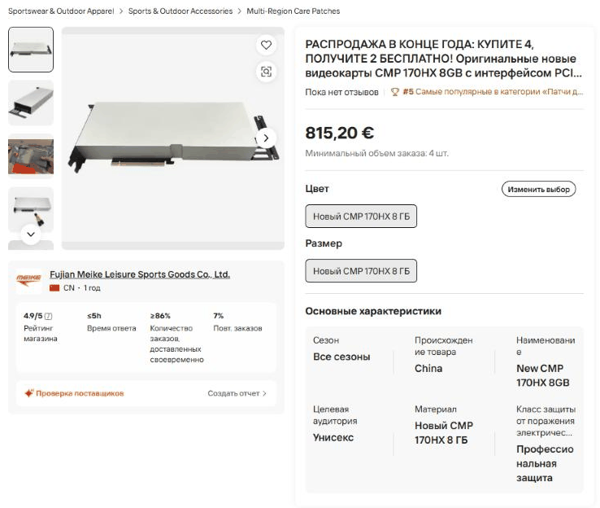
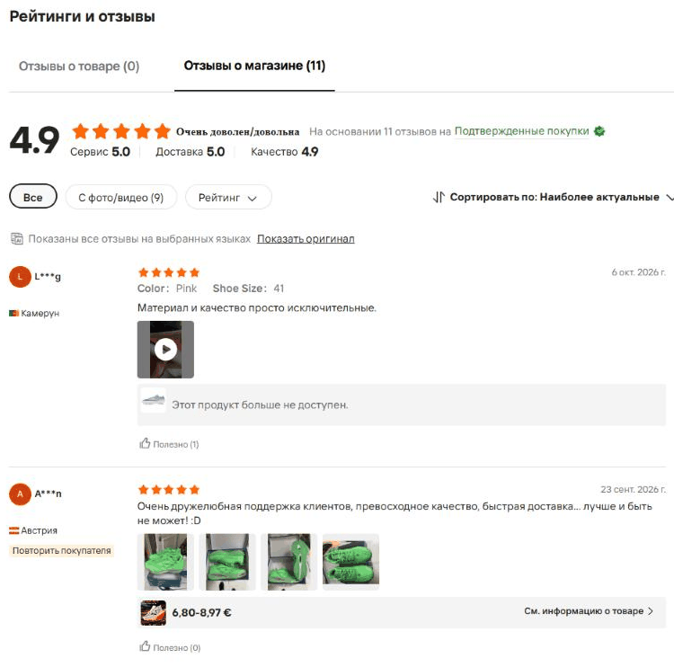
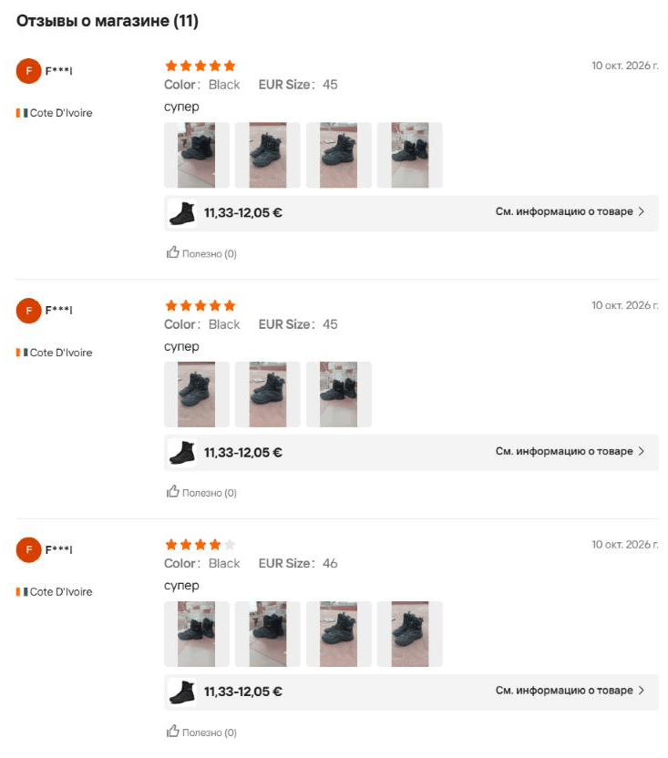
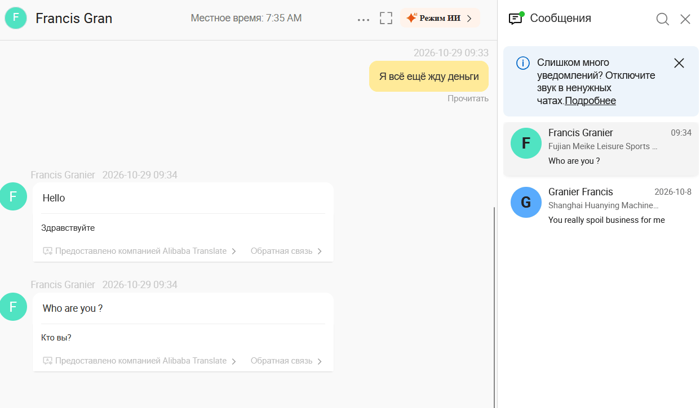

# Осторожно: CMP 170HX на Alibaba в магазине обуви Fujian Meike, продавец Francis Granier (cn1577048581mfwq)

**Это предупреждение, а не обвинение.** Здесь то, что я видел сам, и вопросы, которые стоит задать перед оплатой. Один ли человек стоит за двумя аккаунтами ниже, я доказать не могу, а Francis Granier это отрицает.

В сентябре я заплатил $1700 вне Alibaba контакту Granier Francis (`cn1576475672rxir`, Shanghai Huanying Machinery) за две NVIDIA CMP 170HX и не получил ни карт, ни денег. [Эта история - в отдельном посте](). 28 октября в том чате появилась надпись, что аккаунт удалён.

29 октября в поиске Alibaba мне попалась та же модель от контакта с теми же именем и фамилией, только в другом порядке: Francis Granier (`cn1577048581mfwq`), магазин обувной компании Fujian Meike. Я написал туда, что всё ещё жду деньги, и получил ответ: *«Who are you ?»*

<!--more-->

## Что указано в профиле и объявлениях

Профиль - на 29 октября. Объявления и цены перепроверил 5 ноября: всё на месте.

- **Поставщик:** Fujian Meike Leisure Sports Goods Co., Ltd., магазин `meikeshoes.en.alibaba.com`, Manufacturer + Trading Company, 1 год на Alibaba.com. Основная продукция по профилю - спортивная, повседневная, футбольная, походная и детская обувь
- **Аккаунт на Alibaba:** `cn1577048581mfwq`, в чате - Francis Granier, в профиле - Mr. Francis Granier. Присоединился в 2026 году, транзакций в профиле - 0
- **Почта в профиле:** `mediasales20262026@hotmail.com`
- **Объявления:** четыре CMP 170HX, от $750 до $1000 за штуку, минимальный заказ 3-5 штук. Заголовки - в русской версии Alibaba:
  - «РАСПРОДАЖА В КОНЦЕ ГОДА: КУПИТЕ 4, ПОЛУЧИТЕ 2 БЕСПЛАТНО! Оригинальные новые видеокарты CMP 170HX 8GB…», ID `11000039179313`, $900 (на скриншоте ниже - 815,20 €), от 4 шт.
  - «Оптовая продажа: Купи 5, получи 3 бесплатно! Новая видеокарта CMP 170HX 8GB 10GB…», ID `11000039571151`, $750, от 5 шт.
  - «РАСПРОДАЖА! КУПИТЕ 3, ПОЛУЧИТЕ 1 БЕСПЛАТНО! Новый CMP 170HX 8 ГБ 64 ГБ…», ID `10000050486038`, $900, от 3 шт.
  - «BUY WITH ASSURANCE…» - Alibaba перевела это как «КУПИТЕ СОВЕРШЕНСТВОВАННО ПОДБРАННЫМИ ИНТЕРНЕТ-ПОДХОДЯЩИМИ ПРОДУКТАМИ: НОВИНКА! КУПИТЕ 3, ПОЛУЧИТЕ 1 БЕСПЛАТНО!…», ID `10000050149392`, $1000, от 3 шт.
- **В том же магазине:** экстрактор для чистки ковров Mytee Lite 8070 («ГОРЯЧАЯ РАСПРОДАЖА!», $300, от 2 шт.) и ТВ-приставки VSeeBox V6 Plus («НОВОГОДНЯЯ АКЦИЯ», $70, от 30 шт.). На профиль обувной компании не похоже
- **Часовой пояс:** местное время в шапке чата - UTC+1. У Granier Francis в сентябре было так же

С самой Fujian Meike я дел не имел, денег ей не платил и ни в чём её не обвиняю. По профилю это обувной производитель из Цзиньцзяна: основан в 1999 году, 501-1000 сотрудников, сайт en.meike.cn. Как на её витрине оказались видеокарты, экстрактор для ковров и ТВ-приставки, я не знаю. Это стоит выяснить до оплаты.

## Почему я насторожился

| | Granier Francis, сентябрь | Francis Granier, октябрь |
|---|---|---|
| Аккаунт | `cn1576475672rxir` | `cn1577048581mfwq` |
| Компания | Shanghai Huanying Machinery - судя по названию, оборудование | Fujian Meike Leisure Sports Goods - обувь |
| Почта | `supersaleslimited@gmail.com` | `mediasales20262026@hotmail.com` |
| Товар | CMP 170HX, «LEGIT DEAL» | CMP 170HX, «КУПИТЕ 4, ПОЛУЧИТЕ 2 БЕСПЛАТНО!» |
| Цена | 754,71 € за шт., от 2 шт. | $900 за шт., от 4 шт. |
| Местное время в чате | UTC+1 | UTC+1 |

Совпадают имя с точностью до порядка слов, модель видеокарты и местное время в чате. Оба раза видеокарты продаются из магазина компании другого профиля. Обе компании, судя по профилям, из Китая, а там UTC+8. Как Alibaba считает местное время, я не знаю.

Всё это косвенные признаки, а не доказательство. ID, почта и компании у аккаунтов разные, а имя мог взять кто угодно. Но минимальный заказ в этих объявлениях - от $2700 до $3750, и при такой сумме лучше проверить лишний раз.

## Видеокарта унисекс, на все сезоны

Карточка заведена не в разделе электроники, и это видно:

- **Категория:** Sportswear & Outdoor Apparel → Sports & Outdoor Accessories → Multi-Region Care Patches. Рядом бейдж *«#5 Самые популярные в категории «Патчи для ухода за несколькими областями»»*. Видеокарта была пятой по популярности среди патчей, к 5 ноября стала четвёртой. Экстрактор и приставки из этого магазина лежат в той же категории
- **Характеристики:** «Сезон: Все сезоны», «Целевая аудитория: Унисекс», «Материал: Новый CMP 170HX 8 ГБ» и «Класс защиты от поражения электрическим током: Профессиональная защита»
- **Цвет:** «Новый CMP 170HX 8 ГБ». **Размер:** тоже «Новый CMP 170HX 8 ГБ»
- **«Часто покупают вместе»:** кроссовки для пиклбола, бутсы и ортопедические кроссовки «при бурсите пальцев»
- **Железо из заголовков:** «PCIE x64GB» - такой шины не бывает. В соседних лотах - «8GB 10GB (с возможностью разблокировки до 64 ГБ)» и «PCIe 2.0 x16 - без ошибок». По [спецификациям](https://www.techpowerup.com/gpu-specs/cmp-170hx.c3830) у CMP 170HX 8 ГБ HBM2e и PCIe x4. Перед покупкой уточните, что именно продают

## Рейтинг 4.9 - за ботинки

Под видеокартой: *«4.9 - Очень доволен/довольна. На основании 11 отзывов на Подтвержденные покупки»*, сервис 5.0, доставка 5.0, **качество 4.9**. Отзывов о самом товаре - 0, все 11 - «отзывы о магазине». Alibaba показывает их на карточках товаров магазина, в том числе на видеокартах.

Что внутри:

- *«Color: Pink, Shoe Size: 41. Материал и качество просто исключительные»* - Камерун
- Зелёные кроссовки за 6,80-8,97 € и *«лучше и быть не может! :D»* - Австрия
- *«Color: Blue, Shoe Size: 43. Быстрая доставка»* - Сенегал
- 5 отзывов из 11 подписаны одинаково - F***l из Кот-д'Ивуара. Все 10 октября, все на одни и те же чёрные ботинки за 11-12 €. Тексты: «Хорошее качество», «Супер удобная обувь.», «супер», «супер», «супер»

Я не говорю, что отзывы ненастоящие: ботинки, может, и правда отличные. Но к видеокартам они отношения не имеют: «Качество 4.9» здесь - оценка обуви. А кто не полезет во вкладку с отзывами, увидит пять звёзд и «11 подтверждённых покупок» и может решить, что видеокарты тут уже покупали.

## Что отвечает Francis Granier

В чате на Alibaba:

- 29 октября, 09:33 - я: «Я всё ещё жду деньги»
- 09:34 - *«Hello»*, *«Who are you ?»*
- 09:45 - я: «CMP 170HX 8GB, 2 штуки, за 1700 usdt, всё ещё жду возврат средств»
- 09:47 - *«You've got the wrong person sorry I don't know you»* и *«We don't have any chat history and never purchased from us»*
- 3 ноября, 22:21 - *«You didn't purchase from me»* и *«Why putting my name and company on sub websites»*
- 22:30 - *«I don't know what you are doing but I will let the Interpol look into this»*

Моя оплата за те две карты относится к `cn1576475672rxir`, а не к этому аккаунту. В моём списке чатов они стоят рядом: Francis Granier из Fujian Meike и Granier Francis из Shanghai Huanying Machinery с последним сообщением *«You really spoil business for me»*.

3 ноября под этим постом появился комментарий с GitHub-аккаунта `fgranier827-ctrl`, созданного за две минуты до него. Кто за ним стоит, проверить не могу. Автор пишет от лица Francis Granier и его компании: это *«a typical lie about us»*, покупок и оплат от меня не было, пусть я покажу переписку с его компанией, а купить я мог у другой компании, которая использует его имя (*«impersonating my name»*). Ещё автор обещает сообщить о посте *«to the right authorities»*. Полный текст - в комментариях ниже.

Такой вариант я не исключаю, поэтому это предостережение, а не обвинение. Переписка с этим аккаунтом у меня началась 29 октября, оплат ему и Fujian Meike я не делал и обратного не утверждаю. Если у продавца или компании есть что уточнить, пишите в комментариях: дополню пост.

## Что проверить перед оплатой

- **Подходят ли категория и характеристики.** Видеокарта в «патчах», «унисекс», «на все сезоны» - повод насторожиться
- **Про что отзывы о магазине.** Откройте вкладку и посмотрите, что покупали. «Shoe Size: 41» ничего не говорит о видеокартах
- **Сходится ли профиль с товаром.** Если обувная компания продаёт видеокарты, экстрактор для ковров и ТВ-приставки, спросите почему
- **Откуда такая щедрость.** «Купи 4 - получи 2 бесплатно» на видеокарту за $900 - это две карты даром. Спросите, за счёт чего
- **Какие контакты.** Hotmail или gmail у компании на 500-1000 человек со своим сайтом - повод уточнить контакт через этот сайт
- **Совпадает ли местное время в чате** со страной компании
- **Как просят платить.** Оплата мимо Alibaba - самый важный признак, подробно - в [прошлом посте](). Заказ, оплаченный через Alibaba с Trade Assurance, можно оспорить на площадке. Перевод на карту или в крипте - нет

## Если вы собираетесь покупать

Платите только заказом с Trade Assurance на сайте Alibaba. Что-то кажется странным - на странице товара есть «Сообщить о подозрительной деятельности». Уже заплатили мимо Alibaba - сохраните переписку, подайте жалобу в Alibaba и заявление в полицию и ничего не доплачивайте.

Видели те же контакты или похожую историю - напишите в комментариях.

## English summary

**Warning, not an accusation: CMP 170HX listings on Alibaba from "Francis Granier" (cn1577048581mfwq), storefront of Fujian Meike Leisure Sports Goods Co., Ltd. (meikeshoes.en.alibaba.com).** In September I paid $1700 outside Alibaba to "Granier Francis" (cn1576475672rxir, Shanghai Huanying Machinery) for two NVIDIA CMP 170HX and received nothing ([previous post]()). That account was gone by Oct 28, 2026. On Oct 29 I found a contact with the same two names reversed selling the same GPU model from a sports shoe company's store: four listings at $750-1000 apiece with "BUY 4, GET 2 FREE!"-style titles (IDs 11000039179313, 11000039571151, 10000050486038, 10000050149392), filed under "Multi-Region Care Patches" with attributes "Season: All seasons, Target audience: Unisex". The "4.9 stars, 11 verified purchases" rating shown under the GPU comes from store reviews of shoes ("Shoe Size: 41"). Profile email: mediasales20262026@hotmail.com. Chat local time is UTC+1 on both accounts. I cannot prove the two accounts are the same person, and I made no payment to this account or to Fujian Meike. Francis Granier denies any link ("You've got the wrong person", "You didn't purchase from me"), and a comment below written in that name suggests someone may be impersonating them. Check before you pay, and never pay Alibaba sellers outside Trade Assurance.
