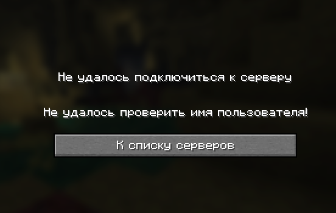

# Собственный Minecraft сервер - авторизация через TLauncher и лицензионные аккаунты в Crafty

Minecraft, запущенный через TLauncher, при входе с локальным ником появлялось «Не удалось проверить имя пользователя!». В консоли Crafty в ту же секунду было видно `Failed to verify username!`. С включённым `online-mode` тот требовал у каждого игрока действующую сессию Minecraft ещё до появления окна AuthMe.

 

Нужно настроить два способа входа. Игрок с локальным ником придумывает пароль для сервера. Владелец ника, привязанного к лицензии, входит с подтверждённой сессией Minecraft.

## Подготовка в Crafty

1. Откройте сервер в Crafty, нажмите **Stop** и дождитесь сохранения мира. Во вкладке **Backups** сделайте свежую копию. Проверьте, что в неё попали `world/`, `plugins/`, `server.properties` и `ops.json`. Если AuthMe уже работает, особенно важен файл `plugins/AuthMe/authme.db` с регистрациями и привязками лицензий. [Резервные копии в Crafty](https://docs.craftycontrol.com/pages/user-guide/backup-manager/).
2. Во вкладке **Files** откройте `plugins/`. Загрузите сборку **AuthMe для Paper** и сборку **PacketEvents для Spigot** под свою версию Minecraft. Оставьте по одному JAR каждого плагина. [Релизы AuthMe](https://github.com/AuthMe/AuthMeReloaded/releases) · [Релизы PacketEvents](https://github.com/retrooper/packetevents/releases).
3. При первой установке запустите Paper с прежним `online-mode=true`. Когда плагины создадут свои каталоги, остановите игру. Дальше файлы можно править прямо в **Files**. [Файловый менеджер Crafty](https://docs.craftycontrol.com/pages/user-guide/file-manager/).

В `plugins/AuthMe/config.yml` выставьте значения **в существующих разделах**.

```yaml
DataSource:
    backend: SQLITE
settings:
    enablePremium: true
    preventOtherCase: true
    sessions:
        enabled: false
    registration:
        enabled: true
        force: true
        type: PASSWORD
        secondArg: CONFIRMATION
        dialog:
            preJoin:
                enable: true
Hooks:
    bungeecord: false
Security:
    SQLProblem:
        stopServer: true
```

Если в мире уже играли, оставьте `online-mode=true` в исходном каталоге и сначала [перенесите профили игроков в копию сервера]().
{: id="если-в-мире-уже-играли"}

В `server.properties` измените две строки.

```properties
online-mode=false
enforce-secure-profile=false
```
